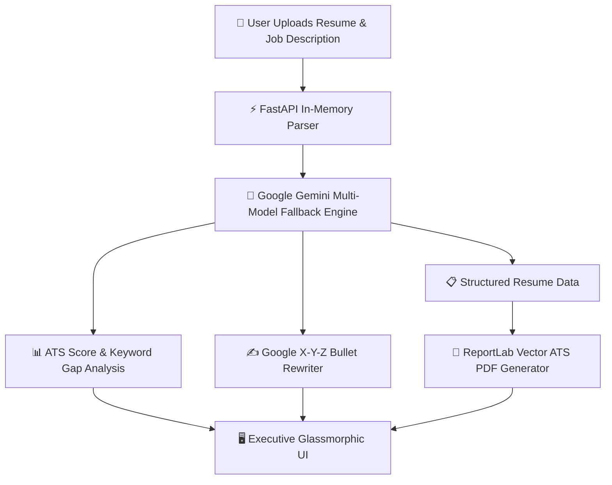

# ResuForge AI — ATS Checker & Executive Resume Builder 🚀

[](https://render.com)
[](https://huggingface.co/spaces/Jaswanth1023/ResuForge-AI)
[](https://github.com/RedamJaswanth/ResuForge-AI)
[](https://fastapi.tiangolo.com)
[](https://www.docker.com/)

> **Engineered for ATS algorithms. Polished for executive recruiters.**

A full-stack application built with **FastAPI** and **Google Gemini** that parses resumes (PDF/DOCX/TXT), evaluates ATS keyword & semantic match against target job postings, rewrites experience bullets using **Google's X-Y-Z formula**, and exports download-ready, ATS-compliant PDFs.

---

### 🌐 Live Demo
👉 **[Open Live App on Render](https://resuforge-ai.onrender.com)**

---

## ✨ Features

- **Multi-Format Resume Ingestion**: Drag & drop support for `.pdf`, `.docx`, and `.txt` files with instant text extraction via `pdfplumber`, `pypdf`, and `python-docx`.
- **ATS Match Scoring (0–100%)**:
  - Radial animated match score gauge.
  - Matched keywords checklist.
  - Critical missing keywords checklist (click to copy).
  - Hard & technical skills gap analysis.
- **Google X-Y-Z Bullet Rewriter**:
  - Automatically transforms passive/weak bullets into:  
    $$\text{"Accomplished [X], as measured by [Y], by doing [Z]"}$$
  - Side-by-side Before/After comparison.
  - One-click **Apply to Resume** and **Copy** buttons.
  - Individual quick-rewriter tool for generating 3 on-demand variants of any bullet point.
- **Download-Ready ATS PDF Generator**:
  - Generates single-column vector PDFs via `reportlab` strictly compliant with legacy and modern ATS parsers (no tables or complex graphics that break scanners).
  - Multiple executive styling themes (Executive Navy, Modern Royal Blue, Minimal Obsidian).
- **Gemini API Key Flexibility**:
  - Set via `.env` file (`GEMINI_API_KEY=...`) or directly via the UI in the browser.

---

## 🏗️ Architecture



---

## 🎨 Theme & Visual Palette

- **Style**: Executive Glassmorphism
- **Primary Background**: Obsidian Navy (`#080C14` / `#0F172A`)
- **Accent AI Color**: Electric Indigo (`#6366F1`)
- **Metric & Link Color**: Cyan / Teal (`#06B6D4`)
- **Score Indicators**: Emerald Green (`#10B981`), Amber (`#F59E0B`), Rose (`#EF4444`)

---

## 🏃 Quick Start

### 1. Install Dependencies
```bash
pip install -r requirements.txt
```

### 2. Configure Your Gemini API Key
Option A: Open `.env` and paste your key:
```env
GEMINI_API_KEY=your_gemini_api_key_here
```
*(Get a free key from [Google AI Studio](https://aistudio.google.com/app/apikey))*

Option B: Enter it directly in the application's top navigation bar settings.

### 3. Run the Application
```bash
python run.py
```
Or with Uvicorn directly:
```bash
uvicorn app.main:app --reload --port 8000
```

Open your browser at:
👉 **`http://127.0.0.1:8000`**

Interactive API Docs:
👉 **`http://127.0.0.1:8000/docs`**

---

## 🐳 Docker & Hugging Face Spaces Deployment

The repository includes a production-ready `Dockerfile` optimized for Hugging Face Spaces (UID 1000, port 7860):

```bash
# Build the Docker image
docker build -t resuforge-ai .

# Run container locally
docker run -p 7860:7860 -e GEMINI_API_KEY="your-api-key" resuforge-ai
```

---

## 🚀 1-Click Render Deployment (Free Web Service)

Deploy instantly on [Render](https://render.com) using the included `render.yaml`:

[](https://render.com/deploy?repo=https://github.com/RedamJaswanth/ResuForge-AI)

Or manually in Render Dashboard:
1. Go to [dashboard.render.com](https://dashboard.render.com) -> **New** -> **Web Service**.
2. Connect your GitHub repository: `RedamJaswanth/ResuForge-AI`.
3. Set **Runtime** to `Python 3`.
4. Set **Build Command**: `pip install -r requirements.txt`.
5. Set **Start Command**: `uvicorn app.main:app --host 0.0.0.0 --port $PORT`.
6. Add Environment Variable: `GEMINI_API_KEY` = your API key.
7. Click **Create Web Service**.
